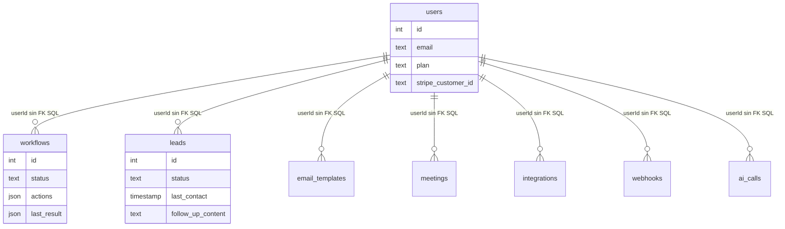
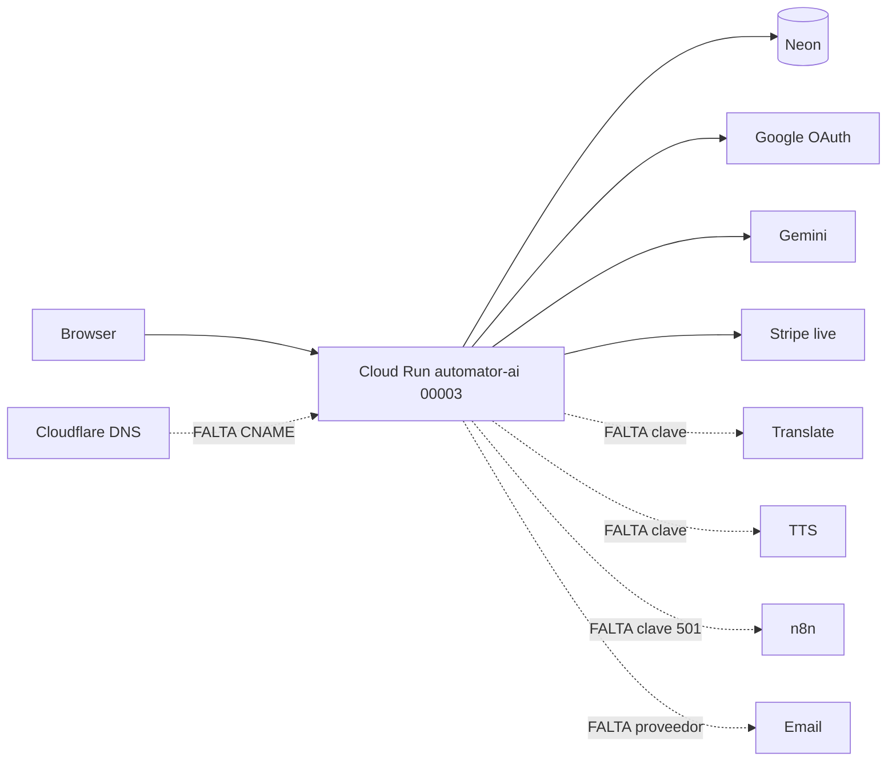
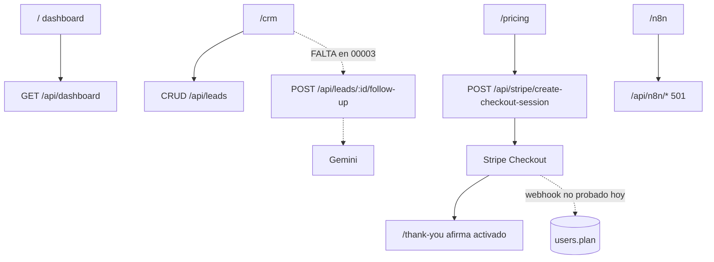
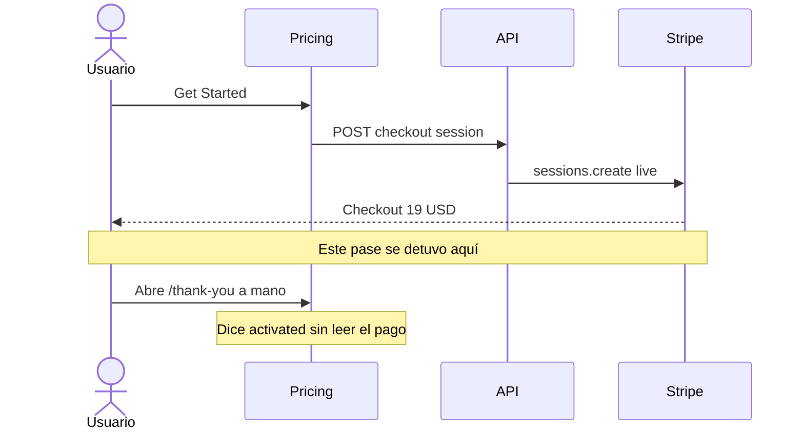

# Biblia — Automator

Generado: 2026-10-18. Auditoría de solo lectura. No se cambió código, base ni Cloud Run.

QC largo: [QC-PAGINAS-Automator.md](./QC-PAGINAS-Automator.md). Plan: [PLAN-FASES-Automator.md](./PLAN-FASES-Automator.md).

## Índice

- [Resumen ejecutivo](#resumen-ejecutivo)
- [A. Identidad](#a-identidad-de-la-app)
- [B. Árbol](#b-árbol-del-proyecto)
- [C. Stack](#c-stack-y-arquitectura)
- [D. Mapa de páginas](#d-mapa-completo-de-páginas)
- [E. QC](#e-qc-página-por-página)
- [F. API](#f-inventario-de-la-api)
- [G. Terceros](#g-servicios-externos)
- [H. Base de datos](#h-base-de-datos)
- [I. Auth y roles](#i-autenticación-roles-e-identidad)
- [J. Planes y pagos](#j-membresías-planes-precios-y-pagos)
- [K. Features](#k-features)
- [L. Flujos](#l-flujos-principales)
- [M. Diagramas](#m-mapa-de-conexiones)
- [N. Huecos](#n-huecos)
- [O. Basura](#o-duplicados-redundancias-y-basura)
- [P. Salud técnica](#p-errores-y-salud-técnica)
- [Q. Seguridad](#q-seguridad)
- [R. Rendimiento, SEO, a11y, móvil](#r-rendimiento-seo-accesibilidad-y-móvil)
- [S. Contenido y marca](#s-contenido-idioma-y-marca)
- [T. Operación](#t-observabilidad-y-operación)
- [U. Historial e índice de reportes](#u-historial-de-lo-hecho)
- [V. Diagnóstico](#v-diagnóstico-honesto)
- [W. Cómo elevarla](#w-cómo-elevar-la-app)
- [X. Plan](#x-plan-de-fases)
- [Notas de redacción](#notas-de-redacción)

## Resumen ejecutivo

Automator (AUTOMATOR AI, paquete `rest-express` 1.0.0) es un panel para anotar leads, reuniones, plantillas y workflows, con login de Google y borradores de Gemini. Está **en producción con huecos, no vendible**. Cloud Run `automator-ai` en `avatar-studios-ai` / `us-east1` sirve la revisión `automator-ai-00003-pjq` (100% del tráfico, `gcloud run services describe`, 2026-10-18). Health público a las 23:50 UTC: database, auth, gemini y stripe en true; translation, textToSpeech y n8n en false. El login y el checkout live de $19 funcionan. El dominio `automator-ai.socialbrands.ai` sigue en CertificatePending. El disco local tiene un cuaderno más honesto (cola, borrador, brief, pasada) que esa revisión no sirve. No hay `.git` en esta carpeta. GitHub `main` termina el 2026-05-03.

---

## A. Identidad de la app

- **Nombre:** AUTOMATOR AI. `APP_NAME` en `cloudbuild.yaml` línea 76. El paquete npm se llama `rest-express` (`package.json` línea 2).
- **URLs que responden:** `https://automator-ai-667496895561.us-east1.run.app` y `https://automator-ai-4spk65slvq-ue.a.run.app` (`status.url` del describe). Health 200 en la numerada, este pase.
- **Dominio previsto:** `automator-ai.socialbrands.ai`. Mapping existe. Ready=False, razón CertificatePending, “You must configure your DNS records” (`gcloud beta run domain-mappings list`, 2026-10-18). `Resolve-DnsName` no devolvió CNAME; solo el SOA de `socialbrands.ai` en `logan.ns.cloudflare.com`. El dominio no resuelve a la app. `VERIFICADO EN VIVO`.
- **Propósito en una frase:** cuaderno de seguimiento comercial con borradores de IA, no un motor que envíe o dispare automatizaciones.
- **A quién le sirve:** una persona que entra con Google y guarda sus propios leads. No hay equipos ni asientos de verdad (el límite `seats` no se consulta).
- **Problema que el sitio dice resolver:** automatizar nurture, reuniones, propuestas y ahorrar 10+ horas. El código no hace eso. Ver sección K.
- **Lugar en el portafolio:** mismo proyecto y región que el hub. OAuth, Gemini y Stripe salen de secrets con prefijo del hub (`cloudbuild.yaml` líneas 77–78). El checkout en vivo rotula el comercio como “Avatar Studios”. La base, la sesión y el webhook de Stripe son de esta app. No se leyó el código de otras apps para esta biblia.
- **Estado:** en producción con huecos. No lista para vender.

## B. Árbol del proyecto

```
Automator-AI-NEW-main/
  client/src/          React: pages, components, hooks, lib
  server/              Express, auth, routes, services
  shared/              schema.ts, membership.ts, notebook.ts
  docs/                VOICEBOX-ASSESSMENT.md y esta biblia
  scripts/             post-merge.sh
  src/                 testConnection.ts (suelto)
  attached_assets/     capturas viejas; no se reabrieron
  dist/                build previo; gitignore
  node_modules/
  google cloud/        carpeta residual; el listado recursivo no terminó. No abierta.
  *.md de QC Replit    raíz, obsoletos (sección U)
```

| Carpeta | Para qué |
|---|---|
| `client/src/pages` | 14 pantallas + 404. Router en `App.tsx` líneas 27–41. |
| `client/src/components/ui` | shadcn. Casi todo es kit, no producto. |
| `client/src/components/layouts` | Sidebar, AppLayout, barra móvil. |
| `client/src/components/dashboard` | `AIWelcomeCard.tsx` y `ConnectionStatus.tsx`, sin imports. |
| `server/services` | Gemini, Stripe, n8n, translate, TTS. |
| `server/auth` + `server/routes/auth.ts` | Google OAuth. |
| `shared` | Tablas Drizzle, planes, reglas del cuaderno. |

Sobran o estorban: `BIBLIA_SISTEMA.md`, `QC_COMPLETE_REPORT.md`, `COMPLETE_SYSTEM_QC.md`, `frontend-qc-report.md`, `FIREBASE_AI_LOGIC_SETUP.md`, `IMPLEMENTATION_TASKS.md`, `stripe_links.ts`, `connection-check.ts`, `qc-report-generator.ts`, `interactive-qc.spec.ts`, `src/testConnection.ts`, el banner de Replit en `client/index.html` línea 11, y la carpeta `google cloud/`. `DEPLOYMENT_STATUS.md` se contradice solo: el cuerpo habla de Firebase y una nota del 2026-10-14 lo desmiente.

## C. Stack y arquitectura

| Capa | Qué es | Evidencia |
|---|---|---|
| Frontend | React 18, Vite 5, Tailwind, Wouter, TanStack Query 5 | `package.json` |
| Backend | Express 4 | `server/index.ts` |
| DB | Neon Postgres vía `pg` | `server/db.ts` |
| ORM | Drizzle. Push, no carpeta `migrations/` | `drizzle.config.ts`; glob de migrations = 0 |
| Auth | Google OAuth + cookie `automator.sid` | `server/routes/auth.ts`, `server/index.ts` líneas 41–59 |
| Colas | No hay | |
| Caché | No hay Redis | |
| Archivos | No hay bucket | |
| Correo | No hay envío. `@sendgrid/mail` está en dependencias y no se importa en `server/` | |
| Pagos | Stripe live, checkout y portal | `server/services/stripe-service.ts` |
| IA | Gemini `gemini-2.5-flash` | `cloudbuild.yaml` línea 76; `gemini-service.ts` línea 34 |
| Observabilidad | `console` y `/api/health`. Sentry no está en código ni en el deploy | |

Local: `npm run dev` → `tsx server/index.ts`, puerto `PORT` o 5000 (`server/index.ts` líneas 108–116). Producción: imagen Docker (`Dockerfile`), `npm run build`, `node dist/index.js`, puerto 8080.

Cloud Run, describe del 2026-10-18: CPU 1, memoria 1Gi, concurrency 80, timeout 60s, maxScale 3, startup CPU boost. Min instances está en `cloudbuild.yaml` línea 72 como 0; el describe de este pase no imprimió minScale. Tráfico 100% en `automator-ai-00003-pjq`. URL canónica del servicio: la de hash. La numerada también responde.

La revisión no tiene commit. Esta carpeta no tiene `.git`. GitHub `eroche3082/Automator-AI-NEW` `main` last push `2026-05-05`, último commit `83f57f6` del 2026-05-03. Producción **no** coincide con `main`. `VERIFICADO`.

## D. Mapa completo de páginas

Router: `client/src/App.tsx` líneas 27–41. Privadas: si no hay sesión, `AppLayout.tsx` líneas 12–28 redirige a `/login`, salvo login, pricing, thank-you y cancelled.

| Ruta | Nombre | Acceso | Propósito | Componente | Estado | ¿Tiene sentido? |
|---|---|---|---|---|---|---|
| `/login` | Login | Pública | Entrar con Google | `Login.tsx` | funciona | mantener |
| `/` | Dashboard | Sesión | Resumen | `Dashboard.tsx` | parcial | mantener, cambiar el copy vivo |
| `/workflows` | Workflows | Sesión | Fichas de workflow | `Workflows.tsx` | parcial | mantener como cuaderno |
| `/crm` | CRM | Sesión | Leads | `CRM.tsx` | parcial | mantener |
| `/email` | Email | Sesión | Plantillas | `Email.tsx` | parcial | mantener como borrador |
| `/calendar` | Calendar | Sesión | Reuniones | `Calendar.tsx` | parcial | mantener |
| `/pricing` | Pricing | Pública | Precios | `Pricing.tsx` | parcial | mantener, alinear features |
| `/thank-you` | Success | Pública | Vuelta de Stripe | `Success.tsx` | parcial | mantener, no afirmar el pago |
| `/cancelled` | Cancel | Pública | Checkout cancelado | `Cancel.tsx` | parcial | mantener, quitar el trial |
| `/connections` | Connections | Sesión | Filas de “integraciones” | `Connections.tsx` | parcial | fusionar con un estado honesto o quitar |
| `/webhooks` | Webhooks | Sesión | URLs guardadas | `Webhooks.tsx` | parcial | quitar hasta que exista un emisor |
| `/settings` | Settings | Sesión | Perfil y plan | `Settings.tsx` | parcial | mantener |
| `/system-health` | Health | Sesión | Flags de servicios | `SystemHealth.tsx` | parcial | reservar a admin |
| `/n8n` | n8n | Sesión | Proxy a n8n | `N8nIntegrationPage.tsx` | parcial (501 sin clave) | quitar del nav hasta que exista n8n |
| 404 | Not found | Según la URL | Fallback | `not-found.tsx` | roto como página de producto | reescribir |
| `/dashboard` | — | No existe | Enlazada desde Success y Cancel | — | rota | quitar el enlace |
| `/terms`, `/privacy` | — | No existen | Settings y login las citan | — | rotas | crear o quitar |

Totales: 14 rutas con componente, más el 404. Funciona: 1 (`/login`). Parcial: 12. Rota o huérfana: `/dashboard`, `/terms`, `/privacy`, y el 404 como experiencia. n8n no está en el sidebar de escritorio y sí en el menú móvil.

## E. QC página por página

El detalle, botón por botón, está en [QC-PAGINAS-Automator.md](./QC-PAGINAS-Automator.md).

Corte de este pase, en vivo, revisión `00003`:

- Login se ve y ofrece Google. Terms y privacy del login son `#`.
- Dashboard: “Overview of your automation system” y “Automatically add leads to CRM and start nurture sequence”. Métricas 0. El disco local ya no dice eso.
- CRM en vivo: “CRM & Lead Automation / Manage leads and automate follow-ups”. Sin tab Due. El disco local sí la tiene.
- Pricing: $19 / $49 / $99. Get Started abrió Checkout live de Starter a $19.00, marca “Avatar Studios”, modo live. Contact Sales no hace nada.
- `/thank-you` dice que la suscripción ya se activó, sin pago. Get Started va a `/dashboard`.
- `/cancelled` promete “14-day free trial” y “Save 10+ hours per week”. Contact Us no hace nada. Back to Dashboard va a `/dashboard`.
- `/terms` con sesión: “404 Page Not Found / Did you forget to add the page to the router?”

Puntajes en el QC: login 4; dashboard y CRM 2; pricing 2; thank-you, cancelled, 404 y legales 1.

## F. Inventario de la API

Fuente: `server/routes.ts` y `server/routes/auth.ts`. Auth: `requireAuth` o el spread `...authed` (mismo middleware, `server/middleware/auth.ts` líneas 28–35). Ningún endpoint mira un rol. El objeto se filtra por `userId` en leads, workflows, meetings, templates, integrations y webhooks (muestra: `routes.ts` líneas 298–299, 412–413, 361–362, 515–516).

| Método | Ruta | Auth | Qué hace | ¿Frontend? | Estado |
|---|---|---|---|---|---|
| GET | `/api/auth/google` | no | Empieza OAuth | Login | funciona (302 en un pase anterior; hoy no se repitió) |
| GET | `/api/auth/google/callback` | no | Cierra OAuth | Google | funciona en el pase del login ya hecho |
| POST | `/api/auth/logout` | no | Borra sesión | Sidebar, Settings | no verificado el clic hoy |
| GET | `/api/auth/session` | no | Usuario o 401 | no hay llamada en `client/src` | duplicado de `/api/me` |
| GET | `/api/health` | no | Flags | nadie en la UI | funciona. JSON vivo citado arriba |
| GET | `/api/me` | sí | Perfil sin ids de Stripe | layout, pricing, settings | 401 sin cookie. Con sesión, el dashboard cargó |
| PATCH | `/api/me` | sí | Nombre, empresa, timezone, idioma, prefs | Settings | no verificado el submit |
| GET | `/api/dashboard` | sí | Conteos y actividad | Dashboard | funciona (ceros en vivo) |
| GET | `/api/qc-report` | sí | Informe interno | no | no verificado |
| CRUD | `/api/workflows` | sí | Fichas | Workflows, builder | no verificado el POST hoy |
| POST | `/api/workflows/:id/run` | sí | Pasada de cuaderno | Workflows local | no está en `00003`. En disco, código |
| CRUD | `/api/leads` | sí | Leads | CRM | no verificado el POST |
| POST | `/api/leads/:id/follow-up` | sí | Borrador Gemini, no envía | CRM local | no está en `00003` |
| CRUD | `/api/email-templates` | sí | Plantillas | Email | no verificado el POST |
| CRUD | `/api/meetings` | sí | Reuniones | Calendar | no verificado el POST |
| POST | `/api/meetings/:id/brief` | sí | Brief Gemini | Calendar local | no está en `00003` |
| CRUD | `/api/integrations` | sí | Filas manuales | Connections, Settings | no verificado |
| CRUD | `/api/webhooks` | sí | URLs, no las dispara | Webhooks | no verificado |
| GET | `/api/ai/welcome` | sí | Texto de bienvenida | `lib/gemini.ts`; la card no está montada | no verificado |
| POST | `/api/ai/email-suggestion` | sí | Borrador | Email vía `lib/gemini.ts` | no verificado hoy |
| POST | `/api/ai/document-suggestion` | sí | Borrador de documento | Email | no verificado |
| GET | `/api/ai/workflow-optimize/:id` | sí | Sugerencias | `lib/gemini.ts` | no verificado |
| GET | `/api/ai/lead-insights/:id` | sí | Texto | `lib/gemini.ts` | no verificado |
| GET | `/api/ai/usage` | sí | Conteo del mes | Settings local | no está en `00003` |
| POST | `/api/translate` | sí | Traducción | `use-translation.tsx` | sin clave no debe inventar. Health false |
| POST | `/api/detect-language` | sí | Detección | no hay llamada en `client/src` | no verificado |
| POST | `/api/text-to-speech` | sí | Audio | `text-to-speech.tsx` si `withTTS` | health false. Nadie pone `withTTS` en true en las páginas |
| GET | `/api/tts/voices` | sí | Voces | no | no verificado |
| GET | `/api/membership/plans` | no | `MEMBERSHIP_CONFIG` | la página de precios no lo usa; trae el array propio | funciona. Body distinto al de la página |
| GET | `/api/stripe/health` | sí | configured/missing | no | no verificado |
| GET | `/api/stripe/connectivity` | sí | Llama a Stripe | no | no verificado. No se llamó para no ampliar superficie |
| POST | `/api/stripe/create-payment-links` | sí | Crea links con el body | no | peligroso: cualquier sesión |
| POST | `/api/stripe/create-checkout-session` | sí | Checkout | Pricing | funciona. Abrió Stripe live |
| POST | `/api/stripe/customer-portal` | sí | Portal | Settings | no verificado |
| GET | `/api/stripe/environment` | sí | Flags, no la clave | no | no verificado |
| POST | `/api/webhooks/stripe` | firma | Actualiza plan | Stripe | no verificado con un evento hoy |
| GET | `/api/n8n/config` | sí | URL base o null | página n8n | no verificado |
| * | `/api/n8n/workflows` y ejecuciones | sí | Proxy | hooks n8n | 501 si no hay clave. Sin sesión, 401 hoy |
| GET | `/api/system/health` | sí | Informe | SystemHealth, ConnectionStatus (muerta) | no verificado el render |
| GET | `/api/system/google-keys` | sí | Booleanos de claves | no | no verificado |

Rutas que el frontend no llama: `/api/auth/session`, `/api/qc-report`, `/api/detect-language`, `/api/tts/voices`, stripe health, connectivity, payment-links, environment, google-keys.

No hay fetch en `client/src` a una ruta que no exista en `routes.ts`. El hueco es al revés: páginas locales llaman `/run`, `/follow-up`, `/brief` y `/api/ai/usage`, que el disco tiene y la revisión `00003` no. Esas llamadas, contra producción, caerían en el 404 JSON de `server/index.ts` líneas 89–92. `NO VERIFICADO` el 404 en vivo porque esas pantallas no están desplegadas.

## G. Servicios externos

| Proveedor | Para qué | Variables | ¿Código? | ¿Cloud Run? | ¿Hoy? | Cobro | Notas |
|---|---|---|---|---|---|---|---|
| Neon | Datos y sesiones | `DATABASE_URL` | sí | secret `automator-ai-DATABASE_URL` | sí, health | plan Neon, no medido | |
| Google OAuth | Login | `GOOGLE_CLIENT_ID`, `GOOGLE_CLIENT_SECRET`, `PUBLIC_BASE_URL` | sí | secrets del hub + env de URL | sí en el host numerado | OAuth sin costo de API relevante | Callback fijo al host numerado |
| Gemini | Borradores | `GEMINI_API_KEY` o `GOOGLE_GENAI_API_KEY`, `GEMINI_MODEL` | sí | el mismo secret del hub en las dos vars; modelo en env | health true. Un borrador de este pase no se pidió | por token | |
| Stripe | Checkout, portal, webhook | `STRIPE_SECRET_KEY`, `STRIPE_PUBLISHABLE_KEY`, `STRIPE_WEBHOOK_SECRET` | sí | secrets del hub + webhook de esta app | checkout live abierto y abandonado | 2.9% + fijo, no calculado | Comercio “Avatar Studios” |
| Translate | Idioma de la UI | `GOOGLE_TRANSLATE_API_KEY` o `GOOGLE_CLOUD_TRANSLATION_API_KEY` | sí | no está en `--set-secrets` | health false | por carácter | |
| Google TTS | Audio | `GOOGLE_TTS_API_KEY` o `GOOGLE_TTS_KEY_ID` | sí | no | health false | por carácter | |
| n8n | Automatizar de verdad | `N8N_API_KEY`, `N8N_API_URL` | sí | no | health false, 501 | instancia propia | El default del servicio es `localhost:5678` (`n8n-service.ts` línea 41). Las rutas no lo llaman si falta la clave |
| Resend | Correo del hub | no la lee este código | no | el secret del hub no está en este servicio | no | | No cableado |
| SendGrid | — | — | dependencia npm, sin import | no | no | | |
| Sentry | Errores | — | no | no | no | | |
| Cloudflare | DNS del dominio | — | no | no hay token aquí | el CNAME no está | | |
| Vertex | — | `GOOGLE_APPLICATION_CREDENTIALS` solo como booleano | dependencia `@google-cloud/vertexai` | no | no | | Muerto |
| Google Calendar / Maps | — | solo booleanos en google-keys | no hay cliente | no | no | | |

### Matriz de entorno

Montadas en Cloud Run (`cloudbuild.yaml` 76–78): `NODE_ENV`, `APP_NAME`, `APP_DOMAIN`, `PUBLIC_BASE_URL`, `GEMINI_MODEL`, `DATABASE_URL`, `SESSION_SECRET`, `GOOGLE_CLIENT_ID`, `GOOGLE_CLIENT_SECRET`, `GOOGLE_GENAI_API_KEY`, `GEMINI_API_KEY`, `STRIPE_SECRET_KEY`, `STRIPE_PUBLISHABLE_KEY`, `STRIPE_WEBHOOK_SECRET`. `PORT` lo inyecta Cloud Run.

El código también lee y **no** están en el deploy: `GOOGLE_AI_API_KEY`, `GOOGLE_API_KEY`, `GOOGLE_GROUP2_API_KEY`, `STRIPE_SECRET_KEY_LIVE`, `STRIPE_PUBLISHABLE_KEY_LIVE`, `STRIPE_API_VERSION`, `N8N_API_KEY`, `N8N_AUTH_TOKEN`, `N8N_API_URL`, `GOOGLE_TRANSLATE_API_KEY`, `GOOGLE_CLOUD_TRANSLATION_API_KEY`, `GOOGLE_TTS_API_KEY`, `GOOGLE_TTS_KEY_ID`, `GOOGLE_MAPS_API_KEY`, `GOOGLE_CALENDAR_API_KEY`, `VERTEX_AI_API_KEY`, `GOOGLE_APPLICATION_CREDENTIALS`.

`.env.example` usa `STRIPE_SECRET_KEY_LIVE` y `APP_DOMAIN` del dominio custom. El deploy usa `STRIPE_SECRET_KEY` y el host numerado. Mismos conceptos, nombres distintos. Los valores de ejemplo son placeholders (`sk_live_your_...`), no claves reales.

## H. Base de datos

Tablas en `shared/schema.ts`: `users`, `workflows`, `leads`, `email_templates`, `meetings`, `integrations`, `webhooks`, `ai_calls`. La tabla `session` la crea `connect-pg-simple` al arrancar (`server/index.ts` líneas 44–47). No está en el schema.

Relaciones Drizzle (`relations()`) de usuario hacia workflows, leads, templates, meetings e integrations. `webhooks` y `ai_calls` no entran en `usersRelations` (líneas 35–41). No hay `.references()` en las columnas `userId`: no hay FK de Postgres declarada en este archivo. Índices: solo uniques de `users` (google_id, email, username, stripe_customer_id). El resto no tiene índice. `VERIFICADO EN CÓDIGO`.

Columnas que el disco añadió y la revisión vieja puede ignorar: `workflows.last_result`, `leads.follow_up_*`, `meetings.brief`, `meetings.brief_at`, tabla `ai_calls`. El push del 2026-10-16 está en el historial, no se repitió hoy. Conteos de filas: **no verificado**. No se abrió la base en este pase. No se copian datos personales.

No hay carpeta `migrations/`. El flujo real es `npm run db:push`.



## I. Autenticación, roles e identidad

- Login: solo Google, scopes `profile` y `email` (`auth.ts` líneas 24–26). Funciona en el host numerado. Evidencia de este pase: el dashboard cargó con sesión y el botón “Cerrar sesión”. El correo no se copia aquí.
- No hay registro aparte, ni verificación de correo, ni reset, ni cambio de contraseña, ni borrado de cuenta, ni 2FA. `VERIFICADO EN CÓDIGO` (no existen rutas).
- Alta: `passport.ts` líneas 46–68. Si el `sub` de Google es nuevo y el email ya existe, enlaza. Si no, crea `plan: "free"`. No pide contraseña.
- Roles: no hay columna. No hay super admin, admin ni cliente. Cualquier sesión llama a system-health y a `create-payment-links`. `VERIFICADO EN CÓDIGO`.
- El hook de membresía trata todo lo que no es `pro` o `elite` como `basic` (`use-membership.ts` líneas 9–11), incluido `free`.

## J. Membresías, planes, precios y pagos

Precios en centavos, iguales en los tres sitios: mes 1900 / 4900 / 9900, año 19000 / 49000 / 99000. El año no tiene botón. Pricing siempre manda `interval: "month"` (`Pricing.tsx` línea 82).

| Código | Página (`Pricing.tsx`) | API `shared/membership.ts` | Checkout (`stripe-service.ts`) |
|---|---|---|---|
| basic | Starter, $19, 5 workflows, “Email Support” | AUTOMATOR AI Basic, 5 workflows, 100 leads, 100 AI | producto “STARTER”, $19. Visto en Stripe |
| pro | Professional, $49, 25 workflows, “Team Collaboration” | Pro, workflows unlimited, 1000 AI | “PROFESSIONAL” en el mapa, no abierto hoy |
| elite | Enterprise, $99, phone 24/7, white-label, SLA | Elite, unlimited AI | “ENTERPRISE” en el mapa, no abierto hoy |

`checkLimit` y `canAccessFeature` no se llaman desde `server/`. Un usuario free crea leads sin tope. `VERIFICADO EN CÓDIGO`.

Flujo: Get Started → si hay sesión, `POST /api/stripe/create-checkout-session` → URL de Stripe. Éxito `/thank-you`, cancelación `/cancelled` (`stripe-service.ts` líneas 235–236). El webhook (`routes.ts` desde la línea 882) actualiza plan en `checkout.session.completed` y baja a `free` al cancelar (línea 977). No se disparó un evento en este pase. `/thank-you` no lee la sesión de Stripe: felicita igual. No hay reembolso en código. No hay trial en el `sessions.create`.

La app publica precios. El copy de beneficios no es coherente con el producto ni entre página y API.

## K. Features

| Feature | Dónde | Estado | Evidencia | ¿Aporta? |
|---|---|---|---|---|
| Login Google | `/login`, auth | completa en el host numerado | dashboard con sesión | sí |
| Leads CRUD | CRM, `/api/leads` | completa como bloc | código + página viva vacía | sí |
| Reuniones CRUD | Calendar | completa como bloc | código. URL no abierta hoy | sí |
| Plantillas | Email | completa como bloc, no envía | código | sí, si el copy lo dice |
| Workflows guardados | Workflows | parcial | se guardan; no se ejecutan fuera de la pasada local | solo como checklist |
| Pasada de cuaderno | `POST /workflows/:id/run` | en disco, no en producción | `routes.ts` 684 | sí, chica |
| Borrador de follow-up | CRM local | en disco, no en producción | `routes.ts` 629 | sí |
| Brief | Calendar local | en disco, no en producción | `routes.ts` 656 | sí |
| Cola “Write today” | Dashboard local | en disco. En vivo no está | screenshot del dashboard viejo | sí |
| Uso de Gemini | Settings local, `ai_calls` | en disco | `routes.ts` 614 | sí |
| Checkout | Pricing | completa hasta Stripe | checkout live abandonado | sí, si los límites existen |
| Límites de plan | `membership.ts` | falsa: no se aplican | sin llamadas en server | sobra hasta que se aplique |
| n8n | `/n8n` | apagada, 501 | health false | sobra en el menú |
| Translate / TTS | hooks y componentes | muertas | health false | sobra hasta tener clave |
| “Connections” | página | demo: JSON manual | `integrations` sin OAuth | sobra así |
| Webhooks de salida | página | demo: no hay emisor | CRUD only | sobra hasta emitir |
| Welcome card | componente | falsa y desmontada | defaults John / 12 / 4.5 | quitar |
| Trial 14 días, 10+ horas, nurture, white-label, phone 24/7 | copy | falsas | páginas vivas | quitar el texto |

## L. Flujos principales

1. Visitante abre el host numerado. `OK` si espera el “Loading...”. El dominio custom no abre. `ROTO`.
2. `/login` → Google → cookie en ese host. `OK` con la sesión de este browser. No se repitió el consentimiento hoy.
3. Onboarding: no existe. Cae en el dashboard.
4. Golden path real: crear lead, crear reunión, pedir borrador, copiar. En producción el copy promete nurture y el código de borrador no está desplegado. `FALTA` en vivo. En disco el camino está escrito y no se clickeó de punta a punta en este pase.
5. Pago: Pricing → Stripe $19 live. `OK` hasta la pasarela. No se pagó. La vuelta `/thank-you` afirma activación sin mirar el pago. `ROTO` como prueba de cobro.
6. Resultado entregado: no hay envío, ni workflow corrido, ni documento generado. `FALTA`.

## M. Mapa de conexiones







## N. Huecos

Prioridad por impacto en vender y operar:

1. Producción y disco no son el mismo producto.
2. El copy vende nurture, trial, white-label y soporte telefónico.
3. No hay envío de email.
4. Los límites de plan no se aplican y `/thank-you` miente.
5. El dominio custom no tiene certificado.
6. No hay roles. Cualquier usuario crea payment links.
7. n8n, Translate y TTS están a medias.
8. No hay páginas legales.
9. No hay git local para publicar el disco.
10. Webhooks de salida y “connections” no conectan con nada.

## O. Duplicados, redundancias y basura

- Tres listas de planes: página, `membership.ts`, `defaultPlans` del stripe service.
- `/api/me` y `/api/auth/session`.
- Dos health: `/api/health` público y `/api/system/health` con sesión.
- Gemini acepta cinco nombres de clave (`gemini-service.ts` líneas 44–48).
- Stripe acepta `STRIPE_SECRET_KEY` y `STRIPE_SECRET_KEY_LIVE`.
- Welcome card y ConnectionStatus, sin uso.
- Documentos de Replit en presente.
- `interactive-qc.spec.ts` busca `/dashboard` y un welcome card en el dominio que no resuelve.
- Banner Replit en `index.html`.
- Dependencias sin uso aparente en el código de la app: `@sendgrid/mail`, `@google-cloud/vertexai`, `memorystore`. `ws` no se importa en `server/` ni `client/src`. No se corrió depcheck. `INFERIDO` como muertas, con esa salvedad.
- `@playwright/test` está en dependencies, no en devDependencies. El spec no se ejecutó.

## P. Errores y salud técnica

- `npx tsc --noEmit` en esta carpeta, 2026-10-18: salida vacía, `TSC_EXIT:0`.
- Lint: no hay ESLint de la app. Solo configs dentro de `node_modules`. No corrido.
- Tests de la app: el spec de Playwright no se corrió. Apunta a un dominio que no resuelve y a un nodo que no está montado.
- Build: no se corrió hoy. Escribiría `dist/`. La imagen en tráfico sí arrancó; el único ERROR de Cloud Run en 14 días es el del 2026-10-15, `ERR_MODULE_NOT_FOUND` `@vitejs/plugin-react`, más el probe de startup cancelado. No hay 5xx nuevos en ese filtro.
- `npm audit` el 2026-10-18, sin `--fix` y sin `--omit=dev`: info 0, low 2, moderate 9, high 15, critical 2, total 28. Críticas: `proxy-addr`, `shell-quote`. Altas incluyen axios, drizzle-orm, ws, vite, postcss, braces, micromatch. El historial citaba 21 el 2026-10-14. El número de hoy es el de este comando. No se parcheó.
- Sentry: sin acceso y sin DSN montado.
- Base: no consultada en este pase.

## Q. Seguridad

- Secretos en el deploy: por nombre, en Secret Manager. No se imprimieron valores.
- `DEPLOYMENT_STATUS.md` dice que una Google API key estuvo en el archivo y se borró el 2026-10-14. No se restauró. Si fue válida, sigue pendiente rotarla. `VERIFICADO` que el archivo lo afirma; no verificado si la clave llegó a ser real.
- `.env.example` solo tiene placeholders.
- Carpeta `google cloud/`: no inspeccionada. Tratarla como posible material sensible hasta una revisión humana. No entra en el commit de esta biblia.
- Rutas públicas correctas: health, planes, login, webhook de Stripe (firma). Rutas que cualquier sesión puede usar y no deberían: `create-payment-links`, system health, google-keys (solo booleanos).
- IDOR: los PUT/DELETE revisados comparan `userId`. `VERIFICADO EN CÓDIGO` en leads, workflows, meetings, templates, integrations, webhooks. No se intentó un id ajeno en vivo.
- Rate limit: no hay. CORS explícito: no hay middleware. Headers de seguridad (helmet): no hay.
- `trust proxy` = 1 junto al aviso crítico de `proxy-addr`.
- Webhook saliente: `secret_key` se guarda en texto en `webhooks` y se devuelve al crear.
- Datos personales: email, nombre e imagen de Google en `users`; email y teléfono de leads. No hay borrado de cuenta.
- Cookie: httpOnly, sameSite lax, secure en producción, 7 días (`server/index.ts` líneas 53–58).

## R. Rendimiento, SEO, accesibilidad y móvil

- Bundle: no medido. No se hizo build hoy.
- Carga: `/pricing` y `/` mostraron “Loading...” hasta que `/api/me` volvió. Min instances 0 implica arranque en frío. Tiempo no cronometrado en este pase más allá de que el health tardó lo bastante para salir del timeout corto.
- SEO: `client/index.html` no tiene `<title>`, description, OG, sitemap ni robots. El document title del browser quedó vacío. `VERIFICADO EN VIVO`.
- A11y: el botón de tema tiene `sr-only`. Contraste del 404 (gris sobre blanco) no se midió. Teclado: `NO VERIFICADO`.
- Móvil: `NO VERIFICADO` en 390px. En código el sidebar se esconde bajo `md`.

## S. Contenido, idioma y marca

- Idioma: UI en inglés, “Cerrar sesión” en español, Pricing mezcla “Inicia sesión antes de suscribirte”. El selector de idioma depende de Translate, que está en false. No hay catálogo de traducciones completo.
- Marca: “AUTOMATOR AI”, cuadrado azul “A”, acento `#0047FF` y `#D100FF`. El checkout dice “Avatar Studios” porque la cuenta de Stripe es la del hub.
- Restos: Replit en `index.html`, Firebase en los MD viejos, 404 de plantilla (“Did you forget to add the page to the router?”), welcome card “John”.
- Legales: no existen. Login y Settings apuntan a sitios vacíos o a `#`.

## T. Observabilidad y operación

- Logs de aplicación: `console` y una línea por request `/api` recortada a 80 caracteres (`server/index.ts` líneas 68–83). No hay request id.
- Health público sin auth. Útil y sin secretos en el JSON visto.
- Alertas: no hay.
- Analítica de producto: no hay.
- Si Gemini falla, las rutas de IA responden error JSON. No se forzó un fallo hoy.
- Si n8n no está, 501 con “n8n is not connected”.
- Costos: Cloud Run min 0, max 3, 1 vCPU, 1 GiB. Neon no medido. Gemini por token, sin tope en servidor: un usuario puede llamar follow-up en bucle cuando eso se despliegue. Stripe es live. El checkout de este pase no se cobró.
- Riesgo de gasto: `create-payment-links` y los `ensureProduct` / `ensurePrice` del checkout crean objetos en la cuenta Stripe compartida. Ya existe un precio STARTER de $19.

## U. Historial de lo hecho

Resumen, alineado con `HISTORIAL-COMPLETO-Automator.md` y vuelto a comprobar donde esta biblia lo dice:

- 2025-01-13 y mayo 2026: QC y commits de Replit. Auth pasó por Firebase, JWT y Google. Último commit de GitHub `83f57f6` el 2026-05-03.
- 2026-10-14 a 15: deploy al hub. Revisión `00001` murió por el import estático de Vite (el log de hoy sigue mostrando ese ERROR). `00003` es la que sirve.
- 2026-10-16: schema nuevo en Neon, según el historial. No repetido hoy.
- 2026-10-18: login ya comprobado; código de cuaderno solo local; Voicebox descartada; dominio sigue pendiente. Esta biblia confirma el dashboard viejo, el CRM viejo, el health, el checkout de $19 y el CertificatePending.

### Índice de reportes

| Ruta | Qué es | ¿Al día? |
|---|---|---|
| `HISTORIAL-COMPLETO-Automator.md` | Cronología hasta el 2026-10-18 | Útil. No sustituye esta biblia |
| `docs/VOICEBOX-ASSESSMENT.md` | No integrar Voicebox | Sí para esa decisión |
| `docs/biblia/BIBLIA-Automator.md` | Este documento | Sí |
| `docs/biblia/QC-PAGINAS-Automator.md` | QC de páginas | Sí |
| `docs/biblia/PLAN-FASES-Automator.md` | Fases propuestas | Sí |
| `BIBLIA_SISTEMA.md` | Biblia de la era Replit | Desactualizada |
| `QC_COMPLETE_REPORT.md` | “92% operational”, Replit | Desactualizada |
| `COMPLETE_SYSTEM_QC.md` | “88%”, 2025-01-13 | Desactualizada |
| `frontend-qc-report.md` | Firebase AI y error 429 | Desactualizada |
| `DEPLOYMENT_STATUS.md` | Firebase, con nota correctiva 2026-10-14 | Desactualizada |
| `IMPLEMENTATION_TASKS.md` | n8n NOT STARTED, estilo Replit | Desactualizada |
| `FIREBASE_AI_LOGIC_SETUP.md` | Setup Firebase | Desactualizada |
| `threat_model.md` | Modelo de amenazas viejo | No reauditado hoy |
| `docs/audit/Automator/qc-completo.md` | Fuera de este repo, en `Apps/docs` | Parcial. La tabla histórica dice “No responde” |
| `docs/audit/Automator/plan-15-fases.md` | Fuera de este repo. 2026-10-15 | Desactualizado: fase 6 sigue “pendiente de prueba” y el login ya se vio |
| `docs/business/Automator/panorama-competitivo.md` | Fuera de este repo | No reabierto hoy |
| `docs/business/Automator/diferenciacion-competitiva.md` | Fuera de este repo | El código que describe no está en `00003` |
| `docs/pending/Automator/00-fuentes.md` | Fuera de este repo. Fase 0 de cierre | La fase 1 de ese megaprompt no existe |

No hay `MEGAPROMPT-*.md` dentro de esta carpeta.

## V. Diagnóstico honesto

La arquitectura de panel (React + Express + Postgres + OAuth + Stripe) sirve para un cuaderno de una persona. No sirve, tal como está, para el producto que el texto vende: automatizaciones que nutren leads, agendan y generan contratos. Eso no está a medio cablear. No existe el emisor. Lo que sí está a medio terminar es el cuaderno honesto del disco, el dominio, los roles y el cobro con límites.

Arreglar: login, CRUD, checkout, health, el copy, el enlace `/dashboard`, los límites, el rol, el CNAME, el deploy del disco.

Quitar: welcome card, connections como si fueran OAuth, webhooks que no disparan, n8n del menú, trial, promesas de horas ahorradas, documentos Replit, banner de Replit.

Reconstruir: no hace falta un stack nuevo. Hace falta decidir que el producto es un cuaderno con IA y cobrar solo por eso. Un runner de automatizaciones sería otro producto.

### Las 10 cosas más graves

1. La revisión en tráfico promete automatizar. El código que lo niega no está publicado.
2. No hay envío de email y varias pantallas hablan como si lo hubiera.
3. Los límites de los planes no se aplican. El cobro es live.
4. `/thank-you` declara la suscripción activada sin comprobarla.
5. Tres listas de features de pago, y la página incluye white-label, SLA y teléfono 24/7.
6. `automator-ai.socialbrands.ai` no tiene certificado ni CNAME.
7. No hay roles. Un cliente puede crear payment links en la cuenta Stripe compartida.
8. Esta carpeta no tiene git. `main` en GitHub es de mayo y no es lo que corre.
9. No hay términos ni privacidad. Los enlaces dan 404 o no navegan.
10. Gemini no tiene tope de servidor. Al desplegar los borradores, el gasto queda abierto. Translate, TTS y n8n siguen a medias.

## W. Cómo elevar la app

| Sugerencia | Esfuerzo | Impacto |
|---|---|---|
| Publicar el cuaderno honesto y borrar el copy de nurture | medio | alto |
| Una sola tabla de planes y límites en el POST | medio | alto |
| `/thank-you` atado al webhook | bajo | alto |
| CNAME y cookie en el dominio | bajo, bloqueado por Cloudflare | alto |
| Rol super admin / cliente | medio | alto |
| Resend del hub, solo con dominio verificado y un buzón de prueba | medio | alto, el día que el producto deba enviar |
| Tope de llamadas Gemini visible en Settings | bajo | medio |
| Sentry del hub, sin imprimir el DSN | bajo | medio |
| Páginas legales y title | bajo | medio |
| No integrar Voicebox, n8n, TTS ni Translate hasta que el cuaderno sea el producto de verdad | — | evita costo |
| Enlazar con otras apps del hub solo como “abrir el otro producto”, no compartiendo tablas | medio | bajo hasta que el cuaderno cierre |

## X. Plan de fases

El plan ejecutable está en [PLAN-FASES-Automator.md](./PLAN-FASES-Automator.md). Fases 0 a 6. Empezar por la Fase 0: sin git y sin deploy del disco, el resto no llega a la URL que la gente abre.

## Notas de redacción

- Correos de la sesión de Google, del mailto de soporte y de la cuenta de Cloud: no se escribieron. Un tipo, varios orígenes. En este documento, cero en claro.
- El checkout de Stripe mostró un email en la página. No se copia.
- No se copiaron API keys, URL de base, client secret, ni el id de la sesión de Checkout.
- Nombres: se usa Edgar como autor del encargo. El nombre completo que pinta el sidebar no se repite.
- No se redactó el project id, los nombres de secrets, ni las URLs `run.app`.
