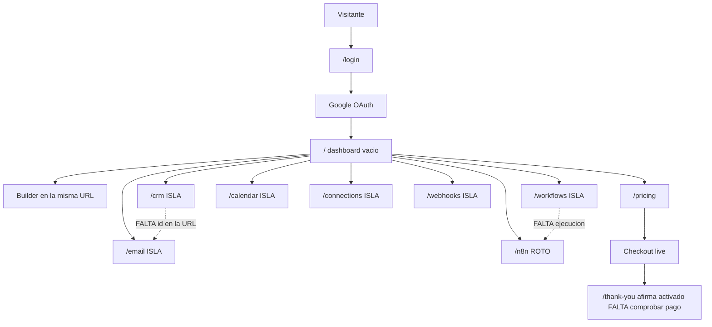

# Cronología real — Automator

Generado: 2026-10-18. Recorrido con sesión en `https://automator-ai-667496895561.us-east1.run.app`, revisión `automator-ai-00003-pjq`.

Capturas: [cronologia-capturas/](./cronologia-capturas/). Biblia: [BIBLIA-Automator.md](./BIBLIA-Automator.md).

## Resumen

No hay un objeto principal. Después de Google el usuario cae en `/`, un dashboard vacío que promete nutrir leads, agendar y generar contratos. CRM, email, calendario, workflows, connections, webhooks y n8n son listas vacías que no se pasan datos entre sí. El único resultado posible sería copiar un texto, y en esta revisión ni el borrador está desplegado. Settings dice “Basic, $19/month, Status: Active” sin que el recorrido haya pagado. No hay onboarding, no hay id en la URL y no hay roles.

## Índice

1. [Objeto y golden path](#1-objeto-principal-y-golden-path)
2. [Recorrido](#2-recorrido)
3. [Análisis](#3-análisis)
4. [Contradicción con la biblia](#4-contradicción-con-la-biblia)

## 1. Objeto principal y golden path

**Objeto principal:** no existe. `VERIFICADO EN CÓDIGO` en `shared/schema.ts`: las tablas son `users`, `workflows`, `leads`, `email_templates`, `meetings`, `integrations`, `webhooks`, `ai_calls`. Ninguna es “el proyecto” de la cuenta. La URL nunca lleva un id (`App.tsx` líneas 27–41).

Lo que la pantalla trata como objeto son tres cosas a la vez:

- el **workflow** (dashboard y `/workflows`)
- el **lead** (`/crm`)
- la **reunión** (`/calendar`)

**Resultado de valor que el usuario viene a buscar**, según el copy en vivo: una automatización que agrega leads, manda nurture, agenda y genera documentos. **Resultado que el código puede entregar:** una fila guardada y, solo en el disco local no desplegado, un texto para copiar. No hay descarga, publicación ni enlace de resultado.

**Flujos que compiten** (todos vistos con sesión el 2026-10-18):

| Flujo | Dónde | Qué promete |
|---|---|---|
| Quick Workflow Builder | `/` | Lead Capture & Nurture, Meeting Scheduler, Document Generation |
| Workflows & Triggers | `/workflows` | “Build and manage automated workflows” |
| CRM & Lead Automation | `/crm` | “Manage leads and automate follow-ups” |
| Email & Document Automation | `/email` | Compose, Templates, Documents, Sequences |
| Calendar & Scheduling | `/calendar` | Reuniones |
| Connection Hub | `/connections` | Integrar servicios externos |
| Webhooks | `/webhooks` | Avisos firmados a otros sistemas |
| n8n | `/n8n` | El motor de automatización |
| Pricing | `/pricing` | Planes con workflows, soporte y white-label |

## 2. Recorrido

Cuenta usada: la sesión de Google ya abierta en el browser. No se creó otra cuenta. No se guardó lead, workflow, reunión ni plantilla. No se pulsó Get Started, Save Workflow, Create, Save as Template ni Manage Billing. No se cerró sesión, para no perder el acceso. Local no se arrancó: el `.env` apuntaría a la misma base de producción.

### 2.1 Entrada

La home de la app es `/`. Sin sesión, `AppLayout.tsx` líneas 24–28 manda a `/login`. Con sesión, `/` es el dashboard.

`/login` (`01-login.png`): un botón, “Continue with Google”. No hay registro con email ni contraseña. Terms y privacy son `href="#"` (`Login.tsx` líneas 92–94): no navegan.

El clic hace `window.location.href = "/api/auth/google"` (`Login.tsx` líneas 23–24). Al volver de Google, el servidor redirige a `/` (`server/routes/auth.ts` líneas 7–8 y 41–42). Por eso un usuario nuevo y uno que ya tiene datos llegan al mismo sitio. Hoy los contadores estaban en 0, así que esta cuenta se comporta como nueva. No hay pantalla distinta para “ya tiene objeto”.

### 2.2 Primer uso

No hay onboarding. El primer uso es el dashboard (`02-despues-login.png`): “Overview of your automation system”, tres ceros, “No activity yet. Create your first workflow, lead or meeting.”

“Create Custom Workflow” abre el builder encima del dashboard (`03-workflow-builder.png`), URL sigue siendo `/`. El nombre ya viene relleno: “New Customer Welcome Sequence”, categoría “Customer Onboarding”, trigger vacío, “Drag an action here”. Exit no cerró el panel en el clic (el árbol siguió mostrando el builder). No se pulsó Save. Según el disco, Save hace `POST /api/workflows` (`WorkflowBuilder.tsx`). En esta revisión no se comprobó el POST porque guardaría un workflow en la cuenta real.

### 2.3 Elegir y abrir el objeto

No hay lista de objetos ni objeto activo. Cada módulo es su propia lista vacía, sin id en la URL y sin recordar una selección. Recargar deja otra vez el dashboard, no un lead abierto.

### 2.4 El camino, paso por paso

**Dashboard** `/` — `Dashboard.tsx`. `GET /api/dashboard`. Guarda nada. Recibe la sesión. Estado: vacío y con promesas falsas. Los tres atajos (“Automatically add leads…”, “Setup meetings…”, “Create AI-powered proposals…”) no son botones en el árbol de accesibilidad; solo “Create Custom Workflow” abre el builder. `02-despues-login.png`.

**Workflows** `/workflows` — título en vivo “Workflows & Triggers / Build and manage automated workflows”. Tabs All, Active, Drafts, Archived. “No workflows .” `GET /api/workflows`. No recibe un lead ni una reunión. `04-workflows.png`. El disco local ya dice “It does not send email”; producción no.

**CRM** `/crm` — “CRM & Lead Automation / Manage leads and automate follow-ups”. Hot, Warm, Cold y Customers en 0. No hay tab Due. “Add your first lead” abre un formulario (Name, Email, Phone, Company, Status, Notes) y no se envió. `POST /api/leads` crearía la fila (`routes.ts` líneas 284–288). El formulario no pide un workflow. `05-crm.png`, `06-crm-formulario.png`.

**Email** `/email` — “Email & Document Automation”. Compose, Templates, Documents y Sequences. Al pulsar Sequences y luego Documents el panel no cambió: siguieron Subject, Content, “AI Writer” y “Save as Template”. `07-email.png`. No hay botón Send. No lee el lead del paso anterior. Guardar crearía `email_templates`. No se guardó.

**Calendar** `/calendar` — “Calendar & Scheduling / Manage meetings and appointments”. Octubre 2026, “No meetings on this day.”, “Upcoming Meetings (0)”. `08-calendar.png`. No está conectado a Google Calendar. No recibe el lead. No se pulsó Schedule Meeting.

**Connections** `/connections` — “Connecting external services lets workflows trigger actions across multiple platforms.” Lista vacía. `09-connections.png`. Es un CRUD manual, no un OAuth. Isla.

**Webhooks** `/webhooks` — “Signed Payloads / Validate signatures with the secret key.” Lista vacía. `10-webhooks.png`. No hay un emisor que haga POST cuando cambia un lead. Isla.

**n8n** `/n8n` — no está en el sidebar de escritorio. La URL directa muestra “Error connecting to n8n” y un enlace a la documentación para instalarlo. `13-n8n.png`. Health dice “n8n is optional and not configured”. La página trata el 501 como si el usuario tuviera que instalar n8n. Isla.

**System Health** `/system-health` — “SOME ISSUES DETECTED”, 4/7. Database 18 ms, Auth, Google AI `gemini-2.5-flash` y Stripe operational. Translate, TTS y n8n en warning. `12-system-health.png`. Es real. No es un paso del camino del usuario; cualquier sesión lo abre.

### 2.5 Resultado y salida

No hay pantalla de resultado, descarga ni publicación. El camino muere en una lista vacía o en un formulario sin enviar.

Créditos: no se descuentan. Settings muestra plan Basic a $19 con “Status: Active” (`11-settings.png`). El hook hace eso aunque `subscriptionStatus` venga vacío: cualquier plan que no sea `pro` o `elite` se pinta como `basic`, y el status cae en `"active"` (`use-membership.ts` líneas 9–11 y 27–29). No se consultó la fila `users` en la base. La pantalla, en vivo, afirma un plan de pago activo.

Pago: `/pricing` (`14-pricing.png`) muestra $19, $49 y $99. No se pulsó Get Started en este recorrido. En la biblia, un clic anterior sí abrió Checkout live y se abandonó sin pagar. Contact Sales no tiene `onClick` (`Pricing.tsx` líneas 188–190).

### 2.6 Interfaz que acompaña

Sidebar de escritorio: Dashboard, Workflows & Triggers, CRM & Leads, Email & Documents, Calendar, Pricing, Connections, Webhooks, Settings, System Health, Cerrar sesión. Todos abren su ruta. n8n no está. El nav móvil sí incluye n8n (`MainContent.tsx` líneas 8–20); no se midió en 390 px.

Notifications: botón visible. El disco lo manda a `/settings` (`Dashboard.tsx` línea 66). El clic no se hizo en este pase. `NO VERIFICADO` en vivo.

Change language: no se cambió. Translate está en warning, así que traducir no tiene clave.

“SOME ISSUES DETECTED” lo dispara `/api/system/health` cuando Translate, TTS o n8n no tienen clave. Es real, no un badge falso. Está en una página aparte, no como alerta del dashboard.

No hay chatbot. La welcome card con datos falsos no está montada.

### 2.7 Regreso

No se cerró sesión. El código de logout hace `POST /api/auth/logout` y `setLocation("/login")` (`Sidebar.tsx` líneas 32–37). Al volver a entrar, Google manda otra vez a `/` (`auth.ts` línea 8), no a un objeto. No hay “último objeto” que recordar.

Otro dispositivo: `NO VERIFICADO`. La cookie es del host numerado, 7 días (`server/index.ts` líneas 53–58). No viaja al dominio custom, que además no resuelve.

### 2.8 Por rol

No hay roles (`schema.ts` no tiene columna de rol). La misma sesión ve System Health, Settings y Pricing. No hay super admin ni cliente que comparar.

## 3. Análisis

### 3.1 Cronología actual

| Orden | URL | Componente | API | Guarda | Recibe el paso anterior | Estado | Evidencia |
|---|---|---|---|---|---|---|---|
| 1 | `/login` | `Login.tsx` | ninguna hasta el clic | no | — | funciona | `01-login.png` |
| 2 | `/api/auth/google` → `/` | `auth.ts` 7–8 | OAuth | sesión | no | funciona | sesión ya abierta; redirect en código |
| 3 | `/` | `Dashboard.tsx` | `GET /api/dashboard` | no | no | vacío, copy falso | `02-despues-login.png` |
| 4 | `/` builder | `WorkflowBuilder.tsx` | `POST /api/workflows` si se guarda | no se guardó | no | demo | `03-workflow-builder.png` |
| 5 | `/workflows` | `Workflows.tsx` | `GET /api/workflows` | no | no | vacío | `04-workflows.png` |
| 6 | `/crm` | `CRM.tsx` | `GET /api/leads` | no | no | vacío | `05-crm.png` |
| 7 | diálogo lead | `CRM.tsx` | `POST /api/leads` si se crea | no se creó | no | formulario real | `06-crm-formulario.png` |
| 8 | `/email` | `Email.tsx` | `GET /api/email-templates` | no | no | tabs que no cambian el panel | `07-email.png` |
| 9 | `/calendar` | `Calendar.tsx` | `GET /api/meetings` | no | no | vacío | `08-calendar.png` |
| 10 | `/connections` | `Connections.tsx` | `GET /api/integrations` | no | no | isla | `09-connections.png` |
| 11 | `/webhooks` | `Webhooks.tsx` | `GET /api/webhooks` | no | no | isla | `10-webhooks.png` |
| 12 | `/settings` | `Settings.tsx` | `GET /api/me` | no se guardó | no | dice plan Active | `11-settings.png` |
| 13 | `/system-health` | `SystemHealth.tsx` | `GET /api/system/health` | no | no | real, 4/7 | `12-system-health.png` |
| 14 | `/n8n` | `N8nIntegrationPage.tsx` | `GET /api/n8n/workflows` | no | no | error de conexión | `13-n8n.png` |
| 15 | `/pricing` | `Pricing.tsx` | checkout si se pulsa | no se pulsó | no | precios públicos | `14-pricing.png` |

### 3.2 Flujos paralelos

Nueve entradas compiten y ninguna entrega el resultado. El dashboard, workflows y n8n hablan de automatizar. El CRM habla de follow-ups automáticos. Email habla de documentos y secuencias, y sus tabs no cambian la vista. Connections y webhooks describen un efecto que el servidor no ejecuta.

Islas: connections, webhooks, n8n, system-health, y las tabs Documents y Sequences del email.

### 3.3 Cronología correcta, una sola

El objeto que sí cabe en esta app es el **lead**. El resultado es un **borrador copiado**, no un envío.

1. Login. Si no hay leads, el alta del primero. Si hay, la cola de los que toca escribir. Ruta propuesta: `/` como resumen y `/crm/:id` como trabajo. Se retira el dashboard como puerta con tres productos imaginarios.
2. Abrir el lead con el id en la URL. El builder de “Welcome Sequence” se retira de la entrada.
3. En la ficha: notas, borrador de Gemini, copiar. La reunión, si existe, se engancha por el texto del lead, no como otro producto. Email, calendario y workflows dejan de ser pipelines y pasan a ser pestañas de esa ficha, o se esconden.
4. Cobro cuando el límite de leads o de llamadas Gemini se pasa. `/thank-you` solo después del webhook. Settings deja de decir Active por defecto.
5. El dashboard queda como conteo. Una sola frase visible: esto no envía.
6. Se quitan del recorrido: n8n, connections como OAuth, webhooks sin emisor, y los tres atajos del dashboard.

### 3.4 Brecha

| Cambio | Archivos | Esfuerzo | Riesgo | Depende de |
|---|---|---|---|---|
| Dejar de prometer nurture, secuencias y documentos en la revisión publicada | `Dashboard.tsx`, `CRM.tsx`, `Email.tsx`, `Workflows.tsx` y un deploy | medio | bajo | Fase 0 de la biblia: git y deploy del disco honesto |
| Poner el id del lead en la URL y abrir esa ficha al entrar si ya hay uno | `App.tsx`, `CRM.tsx`, `AppLayout.tsx` | medio | medio | decidir que el lead es el objeto |
| Hacer que Documents y Sequences muestren otra cosa o quitarlos | `Email.tsx` | bajo | bajo | nada |
| No pintar plan Active ni Basic cuando el plan es `free` y no hay `subscriptionStatus` | `use-membership.ts` líneas 9–11 y 27–29, `Settings.tsx` | bajo | bajo | nada |
| Sacar n8n, connections y webhooks del camino hasta que hagan el trabajo | `Sidebar.tsx`, `MainContent.tsx` | bajo | bajo | nada |
| `/thank-you` no afirma el pago al abrirse | `Success.tsx` | bajo | bajo | webhook |
| No cerrar este documento con un logout forzado | — | — | — | la sesión se dejó abierta a propósito |

No se implementó ninguno.

## 4. Contradicción con la biblia

La biblia describe el disco local (cola “Write today”, tab Due, copy “it is not sent”). Este recorrido con sesión vio la revisión `00003`: “Overview of your automation system”, “CRM & Lead Automation”, “Build and manage automated workflows”, sin tab Due. Las dos cosas son ciertas y no son el mismo producto. La biblia ya lo decía en el resumen; el recorrido lo confirma con captura.

Settings “Status: Active” a $19 no estaba en el recorrido de la biblia. Sale de `use-membership.ts` líneas 27–29 más lo que pintó la pantalla el 2026-10-18 20:45.

## Notas de redacción

El nombre y el correo de la sesión se taparon en el DOM antes de cada captura del panel. En este texto no aparecen. No se copiaron claves ni datos de tarjeta. El checkout no se abrió en este pase.
